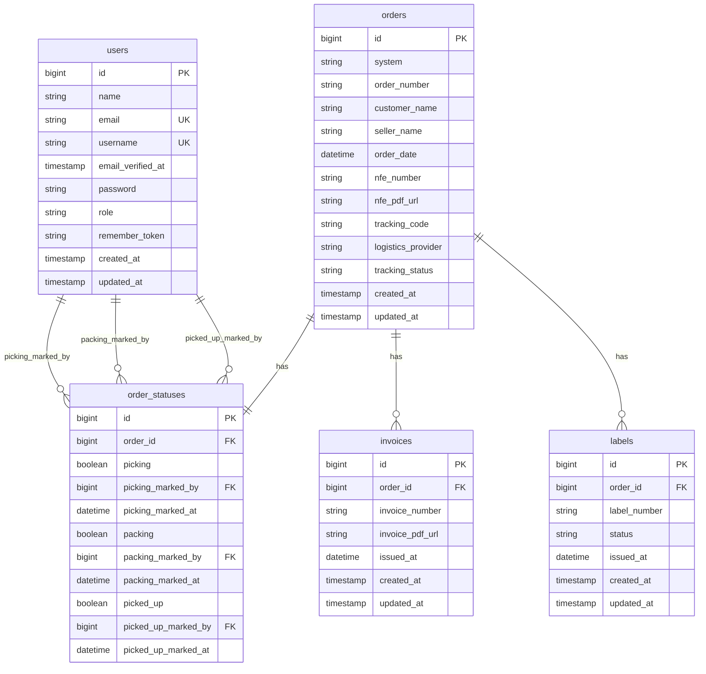

# Database UML Diagram

## Relationships

- **users** 1:N **order_statuses** (picking_marked_by, packing_marked_by, picked_up_marked_by)
- **orders** 1:1 **order_statuses**
- **orders** 1:N **invoices**
- **orders** 1:N **labels**

## Notes

- `users.role` can be: 'admin', 'manager', 'sales'
- `orders.system` can be: 'woocommerce', 'shopify'
- `orders.logistics_provider` can be: 'correios_pac', 'correios_sedex', 'total_express', 'melhor_envio'
- `orders.tracking_status` can be: 'label_issued', 'dispatched', 'in_transit', 'delivered'
- `labels.status` can be: 'issued', 'posted', 'expired'