# Database UML Diagram

```mermaid
erDiagram
    users {
        bigint id PK
        string name
        string email UK
        string username UK
        timestamp email_verified_at
        string password
        string role
        string remember_token
        timestamp created_at
        timestamp updated_at
    }

    order_summary {
        bigint id PK
        bigint bling_id UK
        string numero
        string numero_loja
        datetime data
        datetime data_saida
        datetime data_prevista
        integer total_produtos
        decimal total
        bigint contato_id
        string contato_nome
        string contato_tipo_pessoa
        string contato_documento
        bigint situacao_id
        integer situacao_valor
        bigint loja_id
        string source
        boolean data_processed
        datetime external_updated_at
        string tracking_code
        string logistics_provider
        string service_type
        decimal volume
        decimal weight
        json raw_order_data
        timestamp created_at
        timestamp updated_at
    }

    order_data {
        bigint id PK
        bigint order_summary_id FK
        string numero_pedido_compra
        decimal outras_despesas
        text observacoes
        text observacoes_internas
        decimal desconto_valor
        string desconto_unidade
        bigint categoria_id
        bigint nota_fiscal_id
        decimal total_icms
        decimal total_ipi
        bigint vendedor_id
        string intermediador_cnpj
        string intermediador_nome_usuario
        decimal taxa_comissao
        decimal custo_frete
        decimal valor_base
        integer frete_por_conta
        decimal frete
        integer quantidade_volumes
        decimal peso_bruto
        integer prazo_entrega
        bigint transportador_id
        string transportador_nome
        string etiqueta_nome
        string etiqueta_endereco
        string etiqueta_numero
        string etiqueta_complemento
        string etiqueta_municipio
        string etiqueta_uf
        string etiqueta_cep
        string etiqueta_bairro
        string etiqueta_nome_pais
        json itens
        json parcelas
        json volumes
        json raw_data
        timestamp created_at
        timestamp updated_at
    }

    order_statuses {
        bigint id PK
        bigint order_summary_id FK
        boolean picking
        string picking_marked_by
        datetime picking_marked_at
        boolean packing
        string packing_marked_by
        datetime packing_marked_at
        boolean picked_up
        string picked_up_marked_by
        datetime picked_up_marked_at
        timestamp created_at
        timestamp updated_at
    }

    invoices {
        bigint id PK
        bigint order_summary_id FK
        bigint bling_id UK
        integer tipo
        integer situacao
        string numero
        timestamp data_emissao
        timestamp data_operacao
        string chave_acesso
        decimal valor_nota
        decimal valor_frete
        text xml
        string link_danfe
        string link_pdf
        boolean optante_simples_nacional
        string numero_pedido_loja
        integer serie
        bigint contato_id
        string contato_nome
        string contato_documento
        string contato_ie
        string contato_rg
        string contato_telefone
        string contato_email
        string contato_endereco
        string contato_numero
        string contato_complemento
        string contato_bairro
        string contato_cep
        string contato_municipio
        string contato_uf
        string contato_pais
        bigint natureza_operacao_id
        bigint loja_id
        bigint vendedor_id
        integer frete_por_conta
        string transportador_nome
        string transportador_documento
        string etiqueta_nome
        string etiqueta_endereco
        string etiqueta_numero
        string etiqueta_complemento
        string etiqueta_municipio
        string etiqueta_uf
        string etiqueta_cep
        string etiqueta_bairro
        json itens
        json parcelas
        json volumes
        json raw_data
        timestamp created_at
        timestamp updated_at
    }

    tracking {
        bigint id PK
        bigint invoice_id FK
        bigint volume_id
        bigint pedido_venda_id
        bigint nota_fiscal_id
        bigint servico_id
        bigint embalagem_id
        string codigo_rastreamento
        string descricao
        integer situacao
        string origem
        string destino
        timestamp ultima_alteracao
        string url_rastreamento
        decimal peso
        decimal altura
        decimal largura
        decimal comprimento
        decimal diametro
        date data_saida
        integer prazo_entrega_previsto
        decimal frete_previsto
        decimal valor_declarado
        boolean aviso_recebimento
        boolean mao_propria
        timestamp last_sync_at
        timestamp next_sync_at
        integer sync_attempts
        text last_error
        json raw_data
        timestamp created_at
        timestamp updated_at
    }

    order_status_history {
        bigint id PK
        bigint order_summary_id FK
        string status_type
        boolean status_value
        bigint user_id FK
        timestamp changed_at
        timestamp created_at
        timestamp updated_at
    }

    order_histories {
        bigint id PK
        bigint order_summary_id FK
        bigint user_id FK
        string action
        text description
        json metadata
        timestamp created_at
        timestamp updated_at
    }

    permissions {
        bigint id PK
        string name UK
        string display_name
        text description
        string category
        boolean is_active
        timestamp created_at
        timestamp updated_at
    }

    role_permissions {
        bigint id PK
        string role
        bigint permission_id FK
        timestamp created_at
        timestamp updated_at
    }

    order_summary ||--|| order_data : "has detailed data"
    order_summary ||--|| order_statuses : "has status"
    order_summary ||--|| invoices : "has invoice"
    order_summary ||--o{ order_status_history : "has status history"
    order_summary ||--o{ order_histories : "has operation history"
    invoices ||--o{ tracking : "has tracking"
    users ||--o{ order_status_history : "made changes"
    users ||--o{ order_histories : "performed operations"
    permissions ||--o{ role_permissions : "assigned to roles"
```

## Relationships

- **order_summary** 1:1 **order_data** (detailed order information)
- **order_summary** 1:1 **order_statuses** (picking, packing, picked_up status)
- **order_summary** 1:1 **invoices** (NFE data)
- **order_summary** 1:N **order_status_history** (status change history)
- **order_summary** 1:N **order_histories** (operation history)
- **invoices** 1:N **tracking** (tracking information)
- **users** 1:N **order_status_history** (who made status changes)
- **users** 1:N **order_histories** (who performed operations)
- **permissions** 1:N **role_permissions** (permission assignments)

## Notes

- `users.role` can be: 'admin', 'manager', 'sales', 'developer'
- `order_summary.source` is currently 'bling' (WooCommerce/Shopify planned)
- `order_statuses.picking_marked_by` stores username as string (not FK)
- `order_statuses.packing_marked_by` stores username as string (not FK)
- `order_statuses.picked_up_marked_by` stores username as string (not FK)
- All tables include `created_at` and `updated_at` timestamps
- `raw_order_data` in `order_summary` stores original order data from Bling
- `raw_data` in `invoices` stores complete invoice data for audit trail
- `raw_data` in `tracking` stores complete tracking data for audit trail
- `tracking` table includes sync management fields for external API integration